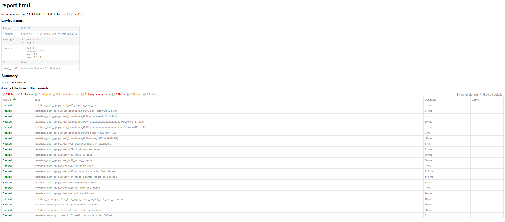
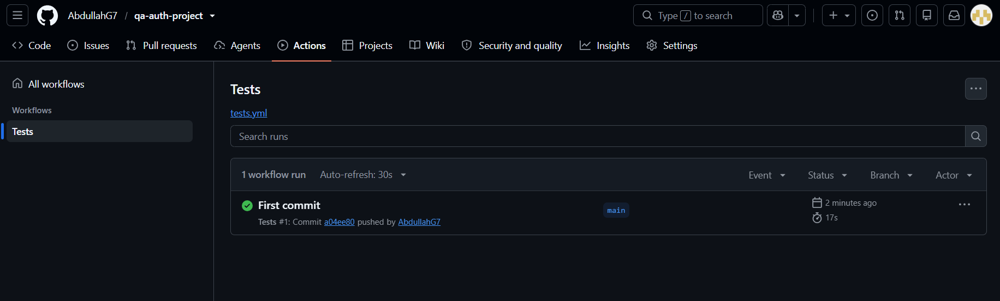
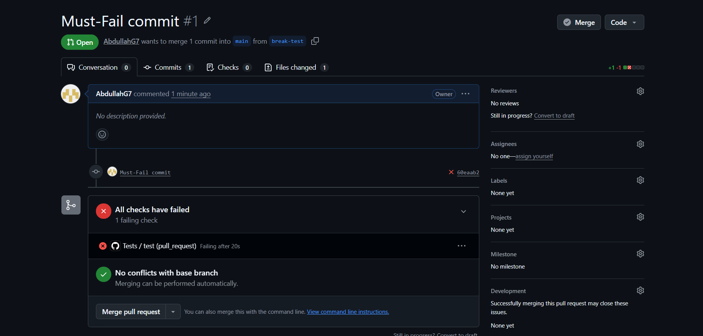
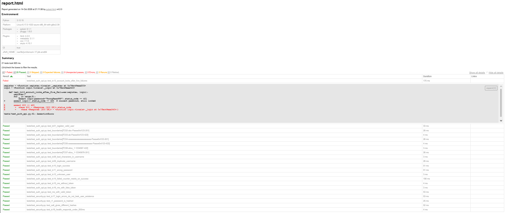

# QA Auth Project: Modern Testing Strategy and Prototype

[](https://github.com/AbdullahG7/qa-auth-project/actions/workflows/tests.yml)

Repository: https://github.com/AbdullahG7/qa-auth-project

## 1. System under test

A small Auth API built with FastAPI. It has four routes.

| Route | Purpose |
|-------|---------|
| `GET /health` | Shows the service is running |
| `POST /register` | Creates a user. Passwords are salted and hashed (PBKDF2-SHA256) |
| `POST /login` | Returns a token. The account locks after 5 failed logins |
| `GET /me` | Returns the user for a valid token |

Data is stored in memory. This keeps the prototype small.

## 2. Test strategy

- **Risk analysis:** [docs/risk_analysis.md](docs/risk_analysis.md). It has 7 risks scored by likelihood and impact. Brute force (R2) has the top score.
- **Quality criteria:** functional and non-functional criteria are in the same file.
- **Test cases:** [docs/test_cases.md](docs/test_cases.md). It has 18 cases. They use boundary values, equivalence classes, decision tables, state transitions and error guessing.
- **Reflection:** [docs/reflection.md](docs/reflection.md). It covers what automation missed and where human judgment was needed.

## 3. Automation

Framework: **pytest** with FastAPI `TestClient`.

| File | Content |
|------|---------|
| `tests/conftest.py` | Resets data before each test. Shared helpers. |
| `tests/test_auth_api.py` | Functional tests (TC01 to TC16) |
| `tests/test_security.py` | Security checks (TC17, hashing, salt) and a performance check (TC18) |

All 18 test cases are automated. There are 21 tests in total, because the boundary cases use one parametrized test and three extra checks were added.

### Security and performance checks

- **Security:** passwords are not stored in plain text. Equal passwords give different hashes. Login errors are the same for a wrong password and an unknown user.
- **Performance:** `/health` responds in under 500 ms.

## 4. Run it locally

With conda:

```powershell
conda create -n QA_auth_env python=3.12
conda activate QA_auth_env
pip install -r requirements.txt
pytest -q --cov=app --cov-report=term-missing --html=reports/report.html --self-contained-html
```

Run only one group:

```powershell
pytest -m security
pytest -m performance
```

The HTML report is saved in `reports/report.html`.

## 5. CI/CD

The workflow is `.github/workflows/tests.yml`. It runs on every push to `main` and on every pull request. It does these steps:

1. Checks out the code.
2. Sets up Python 3.12.
3. Installs the pinned packages from `requirements.txt`.
4. Runs pytest with coverage. The build fails if coverage is below 90%.
5. Uploads the HTML report as the `test-report` artifact.

## 6. Results and evidence

| Run | Result | Evidence |
|-----|--------|----------|
| Push to `main` | 21 passed, 17 s |  |
| Test report, green | 21 passed, 0 failed |  |
| Pull request `break-test` (`MAX_FAILS` changed from 5 to 6) | Failed |  |
| Test report, red | TC13 failed: `200 == 423` |  |

Coverage of `app/main.py` is 100%.

The red run shows that the pipeline catches a real change in behaviour. The pull request was not merged.

## 7. Known limits

- Data is lost when the server restarts.
- Tokens never expire.
- The lockout never resets by time. It can also be used to lock another person's account.
- `/register` shows if a username exists (409).
- Unknown users get a faster login response than known users. This is a timing leak.
- The performance check uses one request, so it is not a load test.

## 8. Project structure

```
QA_auth/
├── app/main.py
├── tests/
│   ├── conftest.py
│   ├── test_auth_api.py
│   └── test_security.py
├── docs/
│   ├── risk_analysis.md
│   ├── test_cases.md
│   ├── reflection.md
│   └── evidence/
├── .github/workflows/tests.yml
├── pytest.ini
├── requirements.txt
└── README.md
```
